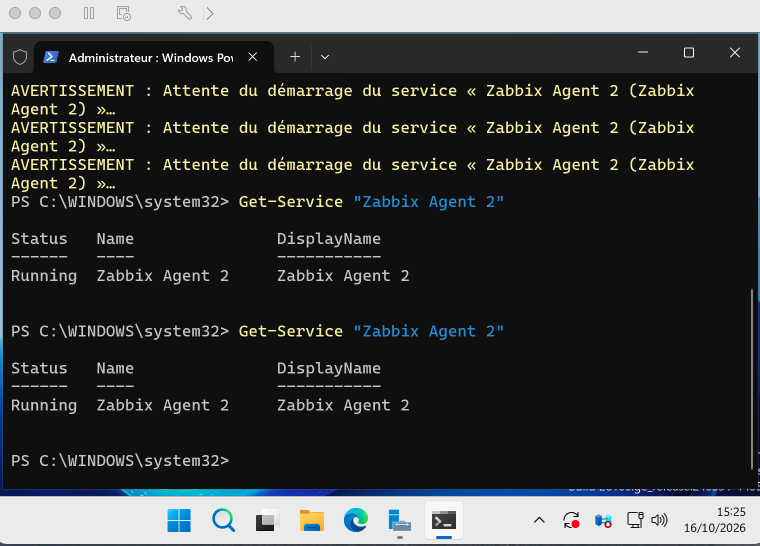

# 03 - Agent Zabbix sur Windows Server 2025

Machine : `srv-windows-01`, Windows Server 2025 Standard (évaluation, build 26100), IP `192.168.209.130`.
Toutes les commandes sont lancées dans PowerShell, ouvert en administrateur.

## 1. Vérifier le réseau

Le Windows doit joindre le serveur Zabbix et Internet (pour télécharger l'agent).

```powershell
ping 192.168.209.129
Test-NetConnection cdn.zabbix.com -Port 443
```

Résultat : 4 réponses sur 4 (0 % de perte) et `TcpTestSucceeded : True`.

## 2. Télécharger l'agent

```powershell
Invoke-WebRequest -Uri "https://cdn.zabbix.com/zabbix/binaries/stable/7.0/7.0.31/zabbix_agent2-7.0.31-windows-amd64-openssl.msi" -OutFile "$env:USERPROFILE\Downloads\zabbix_agent2.msi"
Get-Item "$env:USERPROFILE\Downloads\zabbix_agent2.msi"
```

Le fichier fait environ 18 Mo.

## 3. Installer l'agent en mode silencieux

```powershell
cd "$env:USERPROFILE\Downloads"
Start-Process msiexec.exe -Wait -ArgumentList '/i zabbix_agent2.msi /qn SERVER=192.168.209.129 SERVERACTIVE=192.168.209.129 HOSTNAME=srv-windows-01'
```

| Paramètre | Signification |
|---|---|
| `/qn` | Installation sans fenêtre |
| `SERVER=192.168.209.129` | Seule adresse autorisée à interroger l'agent (le serveur Zabbix) |
| `SERVERACTIVE=192.168.209.129` | Serveur vers lequel l'agent peut envoyer des données (vérifications actives) |
| `HOSTNAME=srv-windows-01` | Nom de la machine dans Zabbix, qui doit être identique au nom de l'hôte déclaré |

## 4. Ouvrir le port 10050 dans le pare-feu Windows

```powershell
New-NetFirewallRule -DisplayName "Zabbix Agent 10050" -Direction Inbound -Protocol TCP -LocalPort 10050 -RemoteAddress 192.168.209.129 -Action Allow
```

Le port n'est ouvert que pour l'adresse du serveur Zabbix, pas pour tout le réseau.

## 5. Vérifier que l'agent tourne

```powershell
Get-Service "Zabbix Agent 2"
```

Résultat attendu : `Status : Running`.


