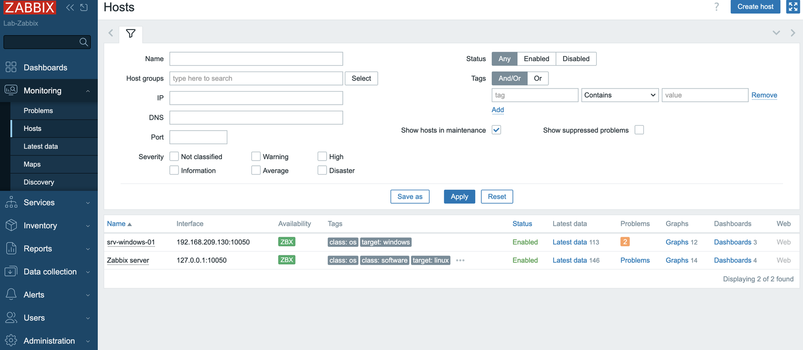
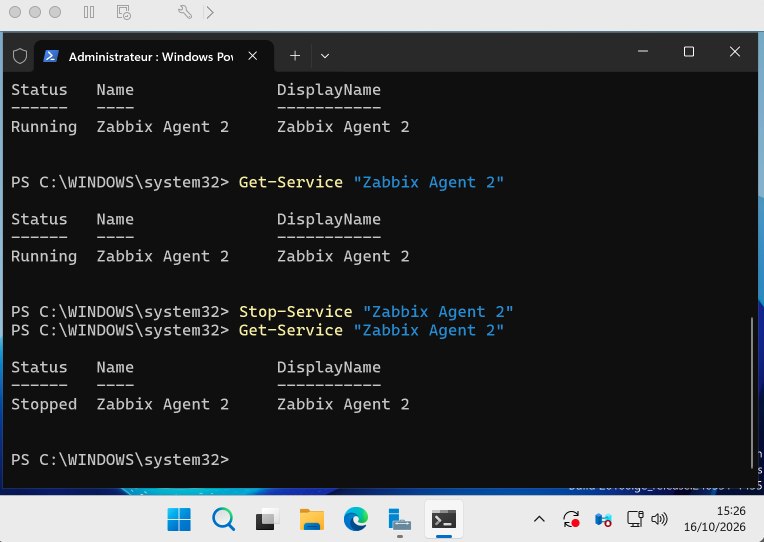
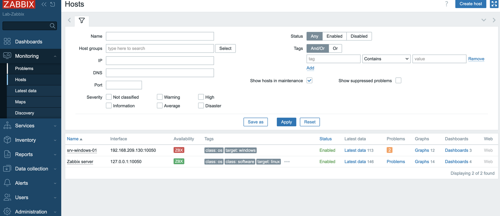
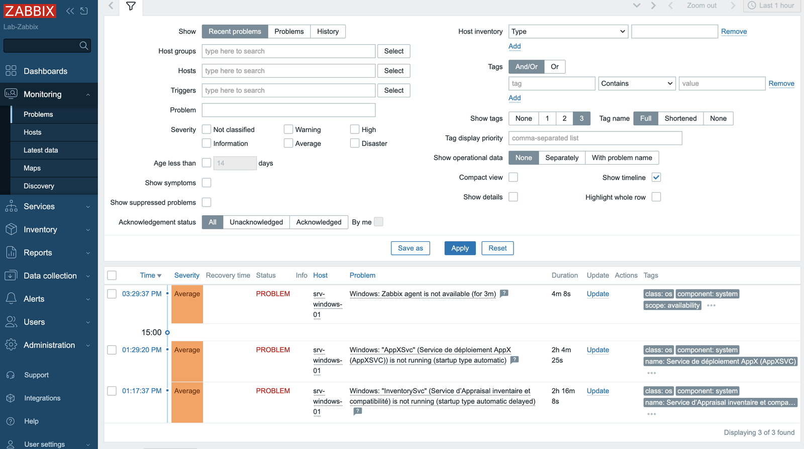
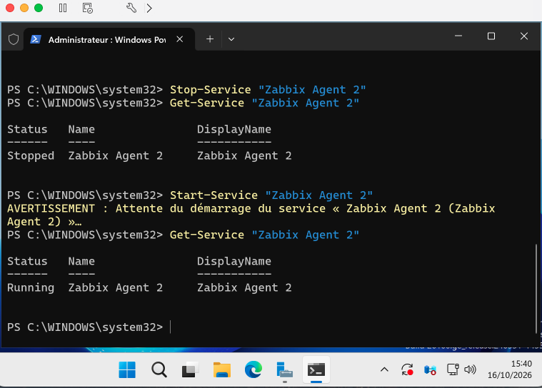
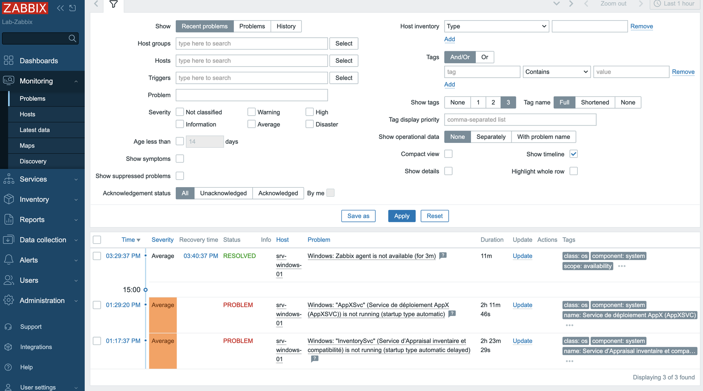

# 04 - Ajout de l'hôte et test d'alerte

## 1. Déclarer l'hôte Windows dans Zabbix

Interface web : **Data collection > Hosts > Create host**.

| Champ | Valeur |
|---|---|
| Host name | `srv-windows-01` (identique au `HOSTNAME` de l'agent) |
| Templates | `Windows by Zabbix agent` |
| Host groups | `Windows server` (créé à cette occasion) |
| Interface | Agent, IP `192.168.209.130`, port `10050` |

Après 1 à 2 minutes, l'icône **ZBX** de l'hôte passe au vert : le serveur joint l'agent. Le modèle apporte 113 éléments de mesure (items) et 79 déclencheurs (triggers) pour cet hôte.



Sur cette capture, `srv-windows-01` affiche déjà 2 problèmes. Ce ne sont pas des pannes : le modèle surveille les services Windows à démarrage automatique, et `AppXSvc` et `InventorySvc` sont des services qui ne tournent qu'à la demande. Ils sont sans rapport avec le test.

## 2. Principe du test

Arrêter l'agent sur Windows : Zabbix ne reçoit plus de réponse, et le déclencheur **Windows: Zabbix agent is not available (for 3m)** doit s'activer au bout de 3 minutes. Puis redémarrer l'agent : le problème doit se résoudre seul.

## 3. Déroulement

**État initial** : agent en marche (`Running`), puis arrêt à 15:26.

```powershell
Stop-Service "Zabbix Agent 2"
Get-Service "Zabbix Agent 2"
```



**Détection** : l'icône ZBX de `srv-windows-01` passe au rouge.



Dans **Monitoring > Problems**, le problème apparaît à 15:29:37, sévérité Average, statut PROBLEM.



**Remise en service** à 15:40 :

```powershell
Start-Service "Zabbix Agent 2"
Get-Service "Zabbix Agent 2"
```



**Résolution** : à 15:40:37, le problème passe en **RESOLVED**, avec une durée totale de 11 minutes.



## 4. Ce que ce test prouve, et ses limites

Prouve : le serveur Zabbix interroge l'agent Windows, détecte son absence, ouvre un problème avec une sévérité, puis le clôture automatiquement quand l'agent revient.

Ne prouve pas : l'envoi d'une notification (e-mail, message). Aucun moyen de notification n'est configuré dans ce lab, l'alerte n'est visible que dans l'interface web.
